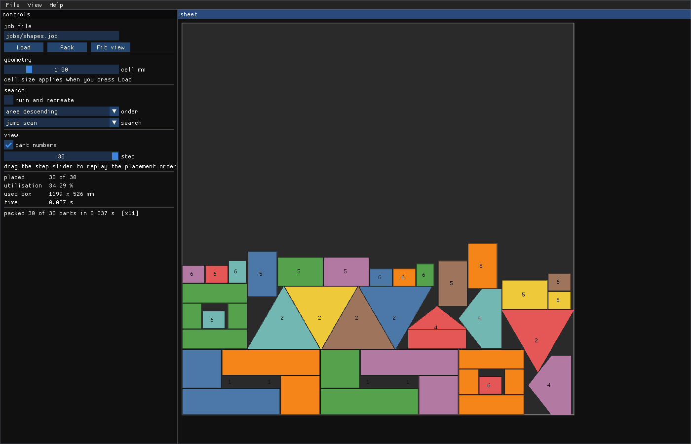

# vibe_binpacker — 2D nesting for sheet material

*[Deze pagina in het Nederlands](README.nl.md)*

Given a set of shapes and a rectangular plate, this decides where to cut each
part so that as little material as possible is wasted. Arbitrary simple
polygons, holes, quarter turns, and a guaranteed gap between parts. The solver
is deterministic C11 with no allocation in the hot path; Python does the
tooling and a separate program does the viewer.



It is free to use and to learn from. It is also a worked example of how I
approach optimisation problems, which is the other reason it is here — see
[when a good algorithm is not the answer](#when-a-good-algorithm-is-not-the-answer).

**Contents** — [Quick start](#quick-start) · [How it works](#how-it-works) ·
[Job format](#the-job-format) · [Viewer](#the-viewer) · [Build](#build) ·
[What the measurements changed](#what-the-measurements-changed) ·
[When an algorithm is not the answer](#when-a-good-algorithm-is-not-the-answer) ·
[Who this matters for](#who-this-tends-to-matter-for) ·
[Work with me](#work-with-me)

---

## Quick start

The only prerequisite is [Pixi](https://pixi.sh); the compiler, Python and the
GUI libraries all come from the environment it creates. Linux, for now.

```sh
pixi run demo
```

That packs the example jobs onto a 1200 × 1200 mm plate with 1 mm between
parts and writes an SVG of each into `build/`:

- [jobs/demo.job](jobs/demo.job) — 36 rectangles.
- [jobs/shapes.job](jobs/shapes.job) — L shapes, triangles, a square frame and
  a five-sided part, at quarter turns.
- [jobs/nested_hole.job](jobs/nested_hole.job) — a frame and a square that can
  only go inside the frame's hole.
- [jobs/dense.job](jobs/dense.job) — more parts than fit, packed with the
  search rather than a single pass.

Every result is then re-checked by
[tools/check_layout.py](tools/check_layout.py), which reads the SVG back and
verifies **independently of the solver** that nothing overlaps, nothing leaves
the sheet, and the clearance holds. That check is not decoration: it is what
caught the clearance being measured between cell centres instead of cell
squares, a bug no unit test of mine would have found because I had written
them against the same wrong idea.

To search rather than make a single pass, give it a budget:

```sh
./build/bp_pack --time 10 --svg out.svg jobs/dense.job
```

On `jobs/demo.job`, five seconds takes the used height from 1134 mm down to
1035 mm — 99 mm more of the plate left as one clean, re-usable strip.

## How it works

The plate is a grid of bits, cell size configurable and 1 mm by default. At
1 mm a 1200 × 1200 sheet is 19 `uint64_t` words per row and 182 KB in total,
so the collision oracle lives in L2 cache. Parts are conservatively rasterised
into bit masks stored as row spans, one mask per allowed rotation. Concave
shapes and polygons with holes need no special code in that representation,
and a part nesting *inside another part's hole* falls straight out of it. The
price is a 1 mm quantisation, which is below the laser kerf.

Clearance follows the literature: each part carries two masks, the true
geometry and a copy grown by the requested gap. The search tests the grown
one, the sheet records the true one, and that leaves exactly the gap you asked
for rather than twice it. The growth is measured between cell *squares* rather
than cell centres, because two cells a diagonal step apart have centres √2
apart but squares that touch at a corner.

Asking where a part fits has two very different answers. For the *first* free
spot, a scan that skips the stretch a blocker rules out wins, because it
usually kills a candidate on its first 64-bit word. For **every** free spot at
a height, the answer is computed rather than searched: intersecting one run
mask per span gives the whole row of legal positions in a handful of word
operations, eleven to thirty times faster than scanning for the same set. That
second answer is one a continuous method cannot give at all, and it is what a
scoring layer needs.

On top of the bottom-left-fill construction sit two search layers:

- **Ruin and recreate** — empty one region of the sheet, put those parts back
  together with anything unplaced, keep the result if it is better.
- **Overlap minimisation** — squeeze the layout into a shorter band, which
  forces parts to overlap, then walk the overlap back to zero with a guided
  local search.

They win on different instances. Reshuffling wins where parts can be reordered
into a better stack; squeezing wins where the order is already right and the
layout merely needs to settle. Neither dominates, which is itself a result
worth knowing.

[PLAN.md](PLAN.md) has the full design and the phased roadmap.
[RESEARCH.md](RESEARCH.md) has the literature review that shaped it, including
why this takes the raster route where the mainstream uses no-fit polygons.

## The job format

Line based on purpose, so the solver needs no parser dependency. DXF and SVG
import belong in tooling that writes these files.

    sheet 1200 1200        # plate size in mm
    cell 1.0               # grid resolution in mm
    clearance 1.0          # gap to leave between parts, in mm

    rect 1 2 600 300 1     # id, quantity, width, height, may turn 90 degrees

    poly 2 4 every:90      # id, quantity, angles: a list like 0,90,180 or
                           # every:<step> for a full turn in equal steps
    ring 6  0 0  300 0  300 80  120 80  120 200  0 200
    ring 4  40 40  80 40  80 80  40 80     # further rings are holes

A `rect` line is sugar for a four-vertex polygon, so there is only one
geometry path. Ring winding does not matter: filling uses the even-odd rule,
because real CAD input arrives wound arbitrarily and guessing at it would be
worse than ignoring it.

## The viewer

A packing is a spatial thing, and a column of numbers hides everything that
matters about it: which corner went wrong, which part is stranded, whether the
waste is one usable strip or scattered slivers.

```sh
pixi run fetch-gui-deps
pixi run gui
./build/bp_gui jobs/shapes.job
```

Drag to pan, wheel to zoom, and drag the step slider to replay the placement
order — the fastest way to watch a heuristic make a bad decision. The controls
re-pack without restarting.

| | |
| --- | --- |
| `Ctrl+O` | open a job, with a small browser that lists `.job` files |
| `Ctrl+R` | reload, picking up an edited file or a new cell size |
| `F5` | pack again |
| `Ctrl+S` | write the layout as SVG |
| `Ctrl+Q` | quit |

Quitting with an unsaved packing asks first, whether you use the menu, the
shortcut or the window button.

The viewer is the only part of this project with a third-party dependency, and
it is fenced off: `pixi run test`, `demo` and `benchmark` never touch it, and
[tools/fetch_gui_deps.sh](tools/fetch_gui_deps.sh) pins the revision rather
than committing a copy of Dear ImGui. The window itself is plain C — cimgui is
the generated C API for Dear ImGui, and the C++ behind it is compiled
separately. Parts go straight into the ImGui draw list as merged rectangles,
so there are no shaders and no textures.

`./build/bp_gui <job> --shot frame.ppm --frames 12` renders a few frames,
writes the framebuffer and exits, which is how a window gets checked from a
script. A GUI that builds is not a GUI that draws.

### If the window appears in the taskbar but stays blank

GLFW prefers Wayland whenever `WAYLAND_DISPLAY` is set; under WSLg its EGL
cannot find a driver, falls back to zink, finds no device, and presents
nothing. The viewer therefore asks for **X11** by default, which works under
WSLg and on native Wayland desktops through XWayland alike. `--platform
wayland` and `--platform auto` override it.

If nothing appears at all, `./build/bp_gui --diagnose` prints the backend, the
GL driver, where the window thinks it is and how many frames it actually
produced, then exits. If that all looks healthy and the screen is still empty,
the display path itself is stuck — under WSL, `wsl --shutdown` from PowerShell
restarts it.

## Build

```sh
pixi run test
```

builds the solver and runs every test. The first run also creates the
environment, which takes a minute.

| task | what it does |
| ---- | ------------ |
| `pixi run build` | compiles the programs and the tests |
| `pixi run test` | builds and runs every test |
| `pixi run test-sanitize` | the same under AddressSanitizer and UndefinedBehaviorSanitizer |
| `pixi run demo` | packs the example jobs and re-checks every result |
| `pixi run benchmark` | sweeps cell size and search mode, prints CSV |
| `pixi run fetch-gui-deps` | clones the viewer's pinned dependencies |
| `pixi run gui` | builds the viewer |
| `pixi run clean` | `rm -rf build` |

Everything the build produces goes under `build/` and nothing else does, so
cleaning is a plain directory removal. Plain `make` works too if you would
rather bring your own toolchain: the Makefile assumes nothing but a C11
compiler, and `make gui` additionally needs GLFW and the OpenGL headers.

Compiler flags are fixed at `-std=c11 -Wall -Wextra -Werror -pedantic`, with
sanitizer runs required for any change to indexing or bit shifting. Tests are
found by wildcard, so adding `tests/test_something.c` is enough to have it
built and run.

    include/   every public header, one per module
    src/       the solver, one implementation file per header
    apps/      bp_pack (the CLI) and bp_bench (the benchmark)
    tests/     one test program per module
    gui/       the viewer
    jobs/      example job files
    tools/     Python tooling
    build/     everything the build produces

## What the measurements changed

This is the part I would actually point at, because it is the difference
between software that looks right and software that is right. Every one of
these overturned the obvious approach, and every one surfaced only because
something was measured. All of them are written up in [PLAN.md](PLAN.md) with
the numbers.

- **The clever jump was the wrong trade.** Skipping ahead as far as all the
  evidence allows cut candidate positions by 0.4 % and cost seventy times more
  work per position. Stopping at the first blocker is 69 times faster.
- **The "real engine" lost.** The plan called morphological erosion the core of
  the method. Measured, it is *slower* than a plain scan for finding the first
  free spot — and eleven to thirty times faster for enumerating every free
  spot, which is a different question and the one that actually matters
  downstream.
- **Clearance measured between cell centres lets parts touch at the corners.**
  Two cells a diagonal step apart are √2 apart by centre and zero apart by
  material. Caught by the independent checker, not by a unit test.
- **A greedy repair loop is a fixed point.** Ruin and recreate produced exactly
  zero improvements over five thousand rounds until the ruin cleared a
  contiguous region and the repair was allowed to skip a few candidates at
  random.
- **A penalty that steers only the choice is not guided local search.** With
  penalties deciding which part moves but not what a position costs, no squeeze
  on a tight sheet ever resolved. Moving the weight into the cost made every
  one resolve, in 15 to 114 iterations instead of stalling at a thousand.
- **Contact scoring, the classic heuristic, did not earn its default.** Any
  positive weight placed five fewer parts than plain bottom-left on an
  over-subscribed sheet. It is implemented, tested, exposed as a flag, and
  defaults to zero.

Negative results are kept on purpose. A repository that only records what
worked teaches you very little about how to get there.

## When a good algorithm is not the answer

A nesting algorithm optimises one thing: the arrangement of parts on one
sheet. That is rarely where most of your material cost is decided.

What decides it is which orders get cut together, which sheet sizes you buy,
whether remnants come back into stock with a usable geometry or get thrown in
the skip, grain and finish direction, cutting sequence and thermal effects,
common-line cutting, clamping zones and tip-up risk on small parts, material
batches and traceability, and — always — what your operators actually do when
the plan is inconvenient. A solver that ignores those can be provably optimal
and still lose money.

And then there is getting it to land. Value appears when it runs inside the
flow you already have: your ERP or MES, your CAM post, your DXF conventions,
your part library, your naming, without anyone retyping anything. That part is
not glamorous and it is most of the work.

I am wary of the shortest route to an answer here. A language model will
produce a plausible plan in a minute, and it will sound right. What it will
not do is measure whether the plan is true for *your* material, *your* machine
and *your* order book. Six of the findings listed above contradict the obvious
approach; not one of them would have survived a confident summary, and each
one was worth real material. I would rather bring you a number than an opinion.

So: use this repository freely. If what you need is a measurable reduction in
waste inside a real production process, that is a different job, and it is the
one I do.

## Who this tends to matter for

Anywhere parts are cut from stock and the offcut is money:

| | |
| --- | --- |
| **Sheet metal** | laser, plasma and waterjet job shops; machine building and their suppliers |
| **Steel construction and shipbuilding** | plate nesting on large formats, where a percent is a lot of tonnes |
| **Furniture and interior fit-out** | CNC nesting in MDF, plywood and chipboard, with grain direction |
| **Glass, plastics, composite panel** | acrylic, polycarbonate, Dibond, honeycomb |
| **Textile, leather, upholstery** | clothing, furniture covers, automotive interiors, with pattern and nap constraints |
| **Packaging and die-cutting** | cardboard and corrugated layouts, cutting dies |
| **Composites** | prepreg and dry fabric kit cutting, where material cost dominates |
| **Insulation, rubber, gaskets** | high-volume cutting from rolls and sheets |
| **Stone, ceramics, worktops** | slabs with natural defects and vein matching — genuinely hard nesting |
| **Signage and print finishing** | foam board, vinyl, Dibond, mixed short runs |
| **Electronics** | PCB panelisation and depanelisation |

If the bottleneck turns out not to be the sheet at all, the same toolbox
covers production planning, order batching and grouping, capacity and shift
planning, routing and scheduling. Operations research is the field; nesting is
one problem in it.

## Work with me

I am **Edwin van den Oetelaar**, an independent software developer in the
Netherlands. I build optimisation software for companies that cut, plan and
schedule — from the algorithm through to the integration with the systems you
already run.

I studied industrial engineering and operations research, which is why these
puzzles are still fun after all these years, and why I would rather measure
than assume. This repository is what that looks like in practice: benchmarks
before claims, negative results kept, and a checker that does not trust the
solver.

My week is split. Three days I teach at Fontys ICT, in software engineering
and information technology. The other two I build, at the edge of what is
possible, with AI and robots — and what I enjoy most is when that reaches the
factory floor. In Brainport the theory of computer science and mathematics
borders on a region that actually makes things, and practical engineers are
what connects those two worlds. That is what I try to give students, and it is
exactly what I do for clients.

This repository belongs to both. A client can see how I work. A student can
see that a problem usually has more than one good answer, and that the wrong
turns are the part you learn from.

### Two ways to go about it

If you have a well-defined challenge and want a concrete result quickly, I do
it myself. That is commercial work, in my own time, and it goes the way this
project went: measure, show what comes out, and only claim something once there
is a number under it.

The other route is a student research project, with me supervising the
content. That works differently, and it is only fair to say so up front:
students have to learn from it first and foremost. They need time to explore
the fundamentals and to get to know your domain, and that takes months where I
would take weeks. What you get in return is something hiring cannot give you:
you watch young engineers work on your real problem for half a year, which is
one of the better ways there is to scout new people.

Which route fits depends on what you need. If there is time pressure, or the
result is critical, the first one is the sensible choice. If you have room and
you are also looking for new talent, the second is worth considering.

> ### Get in touch
>
> **Edwin van den Oetelaar** — independent software developer, Netherlands
>
> - Email: **[edwin@oetelaar.com](mailto:edwin@oetelaar.com)**
> - Phone: **[+31 6 5332 9077](tel:+31653329077)**
> - Web: **[oetelaar.com](https://www.oetelaar.com/)**
> - LinkedIn: **[linkedin.com/in/oetelaar](https://www.linkedin.com/in/oetelaar/)**
>
> Happy to talk through a concrete case: what you cut, out of what, in what
> volumes, and where the waste is now.

## Licence

[MIT](LICENSE) — use it, change it, ship it, commercially or otherwise. Keep
the copyright notice with it and it is yours to do as you like with.

## Conventions

C style follows Pieter Hintjens' Scalable C: one header and one implementation
file per module, `bp_` for public symbols and `s_` for file-local statics,
caller-owned buffers, no global mutable state, units in names
(`width_cells`, `kerf_mm`). Invalid caller input is a programming defect and
fails fast; expected runtime failures return explicit tagged results. See
[AGENTS.md](AGENTS.md).
