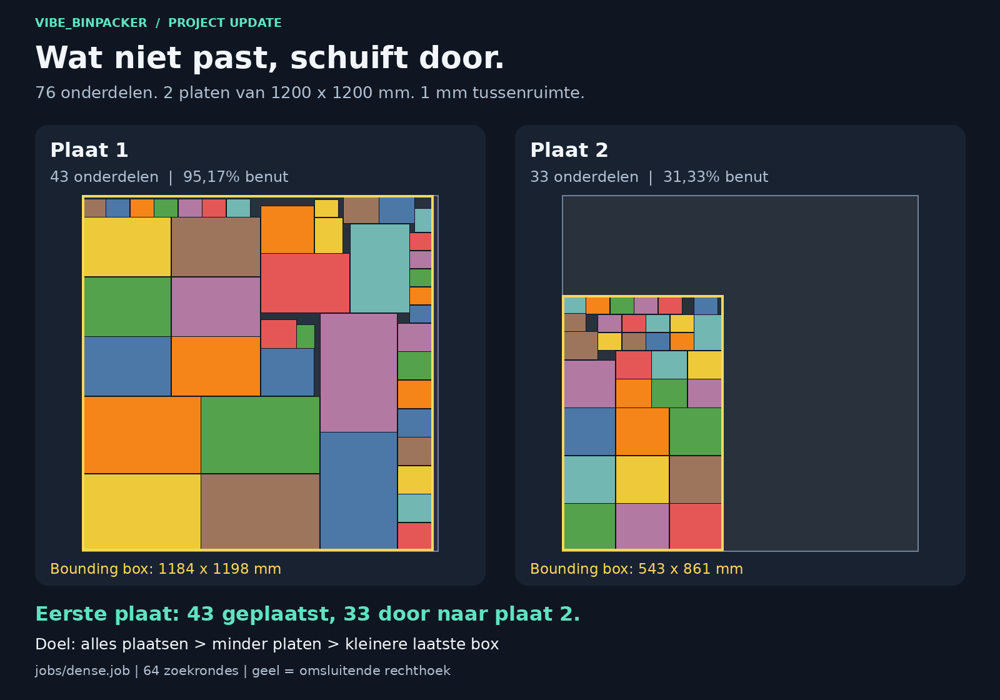
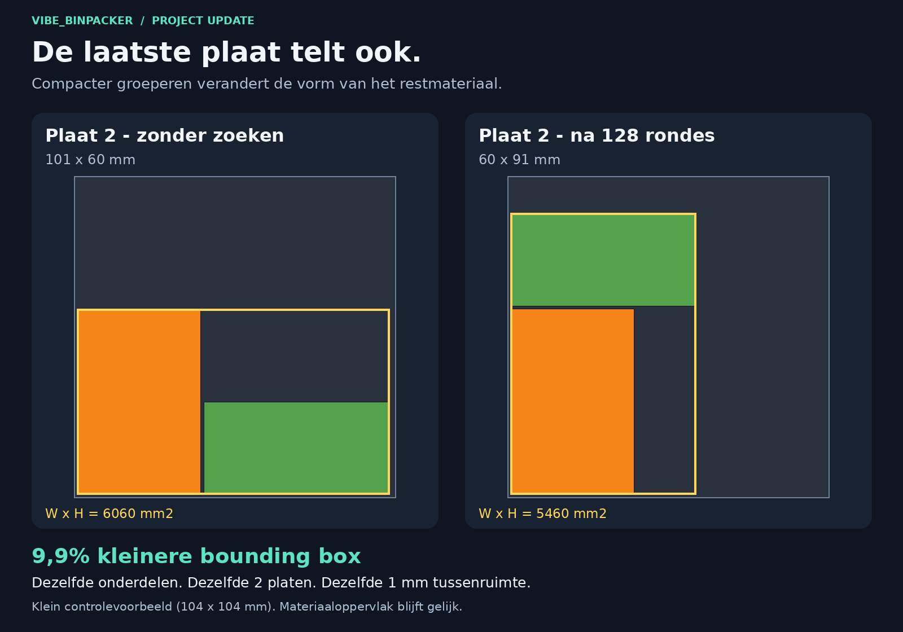
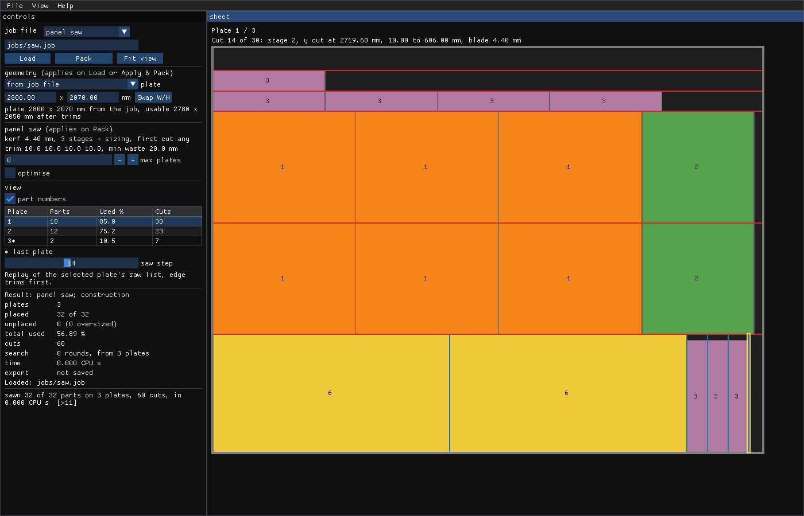
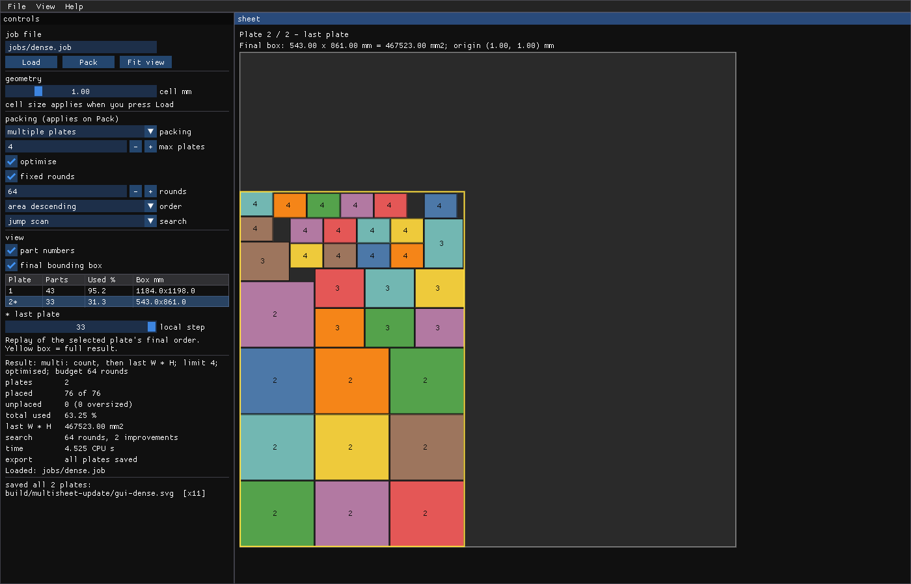
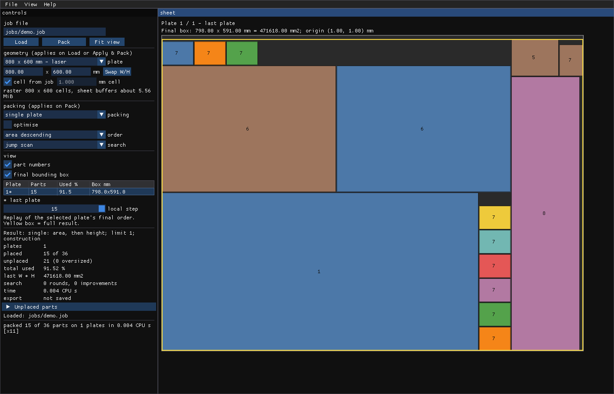

# vibe_binpacker — 2D nesting voor plaatmateriaal

*[This page in English](README.md)*

Je geeft het een set onderdelen en een plaatmaat, en het bepaalt hoe je ze uit
een of meer identieke platen haalt met zo min mogelijk materiaalverlies. Er
zijn twee solvers, voor twee soorten machines:

- **Vrije nesting**, voor laser, plasma, waterstraal en CNC-frees: willekeurige
  polygonen, gaten, elke hoek, en een gegarandeerde tussenruimte.
- **Guillotineversnijding**, voor plaat- en cirkelzagen: rechthoeken, elke
  snede recht van rand tot rand, en een zaaglijst in de volgorde van de zaag.

Beide zijn deterministische C11 die tijdens het rekenen niets alloceert; het
gereedschap eromheen is Python en de viewer is een apart programma.

**Nieuw: een solver voor de zaag.** `bp_pack --guillotine` maakt van een
opdracht een plan dat een plaatzaag kan zagen, met de zaaglijst, een tekening
per plaat en een zoeklaag die platen bespaart.
[Waarom die er is](#waarom-er-een-zaagsolver-is) ·
[Zagen op een plaatzaag](#zagen-op-een-plaatzaag).

**Ook nieuw: kies de plaat.** Elk standaard plaatformaat is een preset, elke
rechthoekige plaat of elk reststuk kun je zelf invullen, en het jobbestand
blijft zoals het is. Daarmee is dit bruikbaar in een echte productieplanning:
nest dezelfde opdracht voor het laserbed, de freestafel of de voorraad van de
zaag, en zie meteen wat het aan platen kost. [Plaatformaten](#plaatformaten) ·
[In de productieplanning](#in-de-productieplanning).

**Ook nieuw: opdrachten over meerdere platen, een kleinere laatste bounding box
en een viewer voor iedere plaat.** [Bekijk de update met beelden](docs/update_multisheet_nl.md):
een complete opdracht met 76 onderdelen op twee platen en een voor/na van de
laatste plaat.



Vrij te gebruiken en van te leren. Het is tegelijk een uitgewerkt voorbeeld van
hoe ik optimalisatievraagstukken aanpak, en dat is de tweede reden dat het hier
staat — zie [wanneer een goed algoritme niet
genoeg is](#wanneer-een-goed-algoritme-niet-genoeg-is).

**Inhoud** — [Twee solvers](#twee-solvers-twee-soorten-machines) ·
[Snel starten](#snel-starten) ·
[Meerdere platen](#meerdere-platen-en-de-laatste-bounding-box) · [Plaatformaten](#plaatformaten) ·
[Hoe het werkt](#hoe-het-werkt) ·
[Jobformaat](#het-jobformaat) · [Viewer](#de-viewer) · [Bouwen](#bouwen) ·
[Wat de metingen veranderden](#wat-de-metingen-veranderden) ·
[Wanneer een algoritme niet genoeg is](#wanneer-een-goed-algoritme-niet-genoeg-is) ·
[Voor wie dit interessant is](#voor-wie-dit-interessant-is) ·
[Samenwerken](#samenwerken)

---

## Twee solvers, twee soorten machines

| | vrije nesting | guillotineversnijding |
| --- | --- | --- |
| machines | laser, plasma, waterstraal, CNC-frees | plaatzaag, balkzaag, cirkelzaag |
| onderdelen | elke polygoon, gaten, elke hoek | rechthoeken, gedraaid of vast door de nerf |
| sneden | het gereedschap volgt elke baan | recht, van rand tot rand, in stadia |
| tussen onderdelen | een gegarandeerde tussenruimte | de zaagbladbreedte, en niets smaller dan de zaag kan afzagen |
| model | een bitraster van 1 mm, conservatief afgerond | een exacte boom van sneden in 0,01 mm |
| je krijgt | een SVG per plaat | een zaaglijst in zaagvolgorde, en een SVG per plaat |
| starten | `bp_pack --sheets 4 job` | `bp_pack --guillotine job` |

Hetzelfde jobbestand dient voor beide: vrije nesting negeert de zaagregels, de
zaag negeert de tussenruimte. Beide hebben een zoeklaag, beide gebruiken
dezelfde plaatformaten, en beide worden gecontroleerd door een programma dat
de solver niet vertrouwt.

### Waarom er een zaagsolver is

Bij Fontys bouwen we robots, en robots hebben kisten nodig om in te reizen. De
studenten ontwierpen de kisten en maakten een zaaglijst voor de platen. Ze
hadden nog niet van de guillotinemethode gehoord, en daardoor had de Hornbach
waar we de platen lieten zagen een aardige uitdaging om alle stukjes te maken.
Een plaatzaag zaagt recht door, van rand tot rand; een lijst die daar geen
rekening mee houdt, laat de puzzel over aan wie achter de zaag staat.

Dat hadden we kunnen voorkomen met onze eigen solver. Dus heeft hij nu een
guillotinemodus: geef hem de onderdelen en de zaag, en je krijgt een plan dat
de zaag kan zagen, in stadia, met de lijst in de volgorde waarin de zager
werkt. Daarmee is de cirkel rond: we liepen tegen een probleem aan, en we
losten het op.

Het is ook precies het soort probleem waar onze engineers bij Fontys bij
kunnen helpen. Ze hoeven de algoritmen niet te bedenken of te bewijzen; dat
heeft de literatuur gedaan, en [RESEARCH.md](RESEARCH.md) laat zien waar. Hun
werk is onderzoek van een andere soort: uitzoeken wat er bestaat, kiezen, het
inbouwen in iets dat draait, en meetbaar maken wat werkt en wat niet. Dat is
een andere creativiteit.

## Snel starten

Het enige dat je nodig hebt is [Pixi](https://pixi.sh). De compiler, Python en
de GUI-bibliotheken komen allemaal uit de omgeving die Pixi voor je aanmaakt.
Voorlopig alleen Linux.

```sh
pixi run demo
```

Dat nest de voorbeeldjobs op een plaat van 1200 × 1200 mm met 1 mm tussen de
onderdelen, en schrijft van elk een SVG naar `build/`:

- [jobs/demo.job](jobs/demo.job) — 36 rechthoeken.
- [jobs/shapes.job](jobs/shapes.job) — L-vormen, driehoeken, een vierkant frame
  en een vijfhoek, op kwartslagen.
- [jobs/nested_hole.job](jobs/nested_hole.job) — een frame en een vierkant dat
  alleen in het gat van dat frame past.
- [jobs/dense.job](jobs/dense.job) — meer onderdelen dan er passen, genest met
  de zoeklaag in plaats van in één doorloop.

Elk resultaat gaat daarna langs
[tools/check_layout.py](tools/check_layout.py). Dat leest de SVG terug en
controleert **buiten de solver om** dat niets overlapt, niets buiten de plaat
valt en de tussenruimte klopt. Die controle is geen franje: hij ving de fout
waarbij de tussenruimte tussen celmiddelpunten werd gemeten in plaats van
tussen de cellen zelf. Geen van mijn unittests had dat gevonden, want die had
ik op hetzelfde verkeerde idee gebaseerd.

Wil je zoeken in plaats van één doorloop, geef het dan een tijdsbudget:

```sh
./build/bp_pack --time 10 --svg out.svg jobs/dense.job
```

Bij `jobs/demo.job` brengt vijf seconden de benutte hoogte terug van 1134 mm
naar 1035 mm. Dat is 99 mm extra plaat die als één rechte, herbruikbare strook
overblijft.

### Meerdere platen en de laatste bounding box

Geef een maximumaantal identieke platen op:

```sh
pixi run build
./build/bp_pack --sheets 4 --time 5 --svg build/multi.svg jobs/dense.job
```

De doelen hebben een vaste volgorde: zoveel mogelijk gevraagde onderdelen
plaatsen, daarna zo weinig mogelijk platen gebruiken, en daarna **breedte
maal hoogte** van de omsluitende rechthoek op de laatste plaat verkleinen.
Die rechthoek omvat de echte geometrie, zonder de tussenruimte of randmarge.
Een hogere maar smallere indeling kan dus beter zijn dan een lage, brede.

Wat niet past schuift door naar de volgende plaat. De zoeklaag probeert
andere onderdeelvolgordes, en daarmee andere verdelingen over de platen,
en smallere containers voor de laatste plaat. Deze eerste multi-plaatheuristiek
gebruikt bottom-left-constructie en bewaart de beste gevonden oplossing;
een bewezen minimum levert hij niet. `--sort` en `--mode` sturen de
constructie. `--contact`, `--window`, `--ruin`, `--blink` en `--compact`
horen bij de zoeklaag voor een enkele plaat en worden hier geweigerd.

`--time` is een zacht CPU-tijdsbudget, gecontroleerd tussen volledige
kandidaten. Gebruik een vast aantal rondes voor herhaalbare vergelijkingen:

```sh
./build/bp_pack --sheets 2 --search 128 --svg build/overflow.svg jobs/multisheet.job
```

Zonder `--search` of `--time` krijg je de constructieve beginoplossing.
De kleine voorbeeldjob vult plaat 1 en laat twee onderdelen naar plaat 2
doorschuiven.



In dit controlevoorbeeld verkleinen 128 zoekrondes de bounding box van 6060
naar 5460 mm2: **9,9% kleiner**, met dezelfde onderdelen, twee platen en 1 mm
tussenruimte. De materiaaloppervlakte blijft gelijk; de vorm van de resterende
ruimte verandert. [Lees waarom dat waardevol is](docs/update_multisheet_nl.md).

De uitvoer bestaat uit `build/overflow-001.svg`,
`build/overflow-002.svg`, enzovoort: een bestand per gebruikte plaat.
`--csv` schrijft per plaat de oorsprong, breedte, hoogte en oppervlakte van
de bounding box en de benuttingsgraad. Exitcode 0 betekent alles geplaatst,
2 een geldige gedeeltelijke oplossing en 1 een invoer- of uitvoerfout.
Niet-geplaatste onderdelen worden op stderr vermeld. Oude SVG-bestanden
van een eerdere run met meer platen behoren niet tot het nieuwe resultaat.

### Plaatformaten

Het plaatformaat komt uit de `sheet`-regel van de job. Om dezelfde job op een
andere rechthoekige plaat te nesten zonder het bestand aan te passen, geef je
een override:

```sh
./build/bp_pack --sheet-size 800 600 --svg build/laser.svg jobs/demo.job
./build/bp_pack --sheet-size 1250 2500 --cell 0.5 --svg build/large.svg jobs/demo.job
```

Breedte en hoogte worden genomen zoals ze gegeven zijn en nooit verwisseld;
`--sheet-size 600 800` is dezelfde plaat gedraaid. Een rechthoekig reststuk
is gewoon een andere maat. Het jobbestand wordt nooit gewijzigd. Met
`--sheets` hebben alle platen in de run het opgegeven formaat. Onderdelen die
niet op de kleinere plaat passen worden als niet-geplaatst gemeld (exitcode
2), niet verkleind of weggelaten. De plaat wordt naar beneden afgerond op hele
cellen: een reststuk van 730,5 mm wordt bij 1 mm cellen als 730 mm gemodelleerd
en geexporteerd, nooit groter dan de echte plaat.

De celgrootte weegt zwaarder dan de millimeters: halveer je de cel, dan
verviervoudigt het aantal cellen, en naast de bitboard houdt de loader per
cel een telling van 4 bytes en een lopend totaal van 8 bytes bij voor de
zoeklaag. `bp_pack` en de viewer weigeren daarom een raster boven een vast
budget, nog voordat er iets wordt gealloceerd:

- hoogstens 8192 cellen langs een as,
- hoogstens 16.000.000 cellen in totaal,
- hoogstens 256 MiB aan plaatbuffers.

Dat zijn productgrenzen, geen gemeten hardwaremaximum, en ze begrenzen niet
het totale procesgeheugen. Wat ze betekenen voor de gangbare maten:

| plaat in mm | cel in mm | rastercellen | plaatbuffers in MiB | |
| --- | ---: | ---: | ---: | --- |
| 800 x 600 | 1,0 | 480.000 | 5,56 | ok |
| 800 x 600 | 0,25 | 7.680.000 | 88,83 | ok |
| 1250 x 2500 | 1,0 | 3.125.000 | 36,16 | ok |
| 1250 x 2500 | 0,5 | 12.500.000 | 144,62 | ok |
| 1250 x 2500 | 0,25 | 50.000.000 | 578,31 | geweigerd |

Een geweigerde maat zegt waarom en stelt de fijnste celgrootte voor die wel
past. Maat of resolutie worden nooit vanzelf aangepast:

```text
bp_pack: jobs/demo.job: job is too large for the chosen cell size:
1250 x 2500 mm at 0.25 mm is 5000 x 10000 cells, more than 8192 along an
axis; try 0.5 mm cells
```

`pixi run benchmark` gebruikt de oude loader zonder deze grenzen, zodat de
resolutiesweep nog steeds tot 0,25 mm op een plaat van 1200 mm loopt.

### In de productieplanning

Nu het plaatformaat vrij is, kan een planner doen wat de werkvloer nodig heeft:

- **Laseren, plasmasnijden en waterstralen.** Nest op het machinebed,
  bijvoorbeeld 800 x 600 mm, en krijg per plaat een SVG met gegarandeerde
  tussenruimte. Onderdelen die niet passen worden gemeld, niet weggelaten.
- **Frezen.** Volle platen zoals 1250 x 2500 mm, met de tussenruimte op de
  freesdiameter, zodat elk onderdeel zijn freesbaan houdt.
- **Reststukken.** Vul de rechthoek in die nog in het rek staat en nest de
  volgende opdracht daarop, voordat je een nieuwe plaat aansnijdt.
- **Voorraad vergelijken.** Draai dezelfde opdracht op 1250 x 2500 en op
  1200 x 1200 en vergelijk het aantal platen en de grootte van de bounding box
  op de laatste plaat, voordat je materiaal bestelt.

Elke run is herhaalbaar: dezelfde job, maat en `--search`-rondes geven
hetzelfde legplan, en de exitcode en CSV-uitvoer van de CLI passen in een
planningsscript.

**Zagen.** Een plaat- of balkzaag maakt alleen rechte sneden van rand tot
rand, dus vrije legplannen zijn niet voor de zaag. `bp_pack --guillotine` maakt
legplannen die dat wel zijn: elke plaat wordt in stadia gezaagd, eerst de
stroken, en krijgt een zaaglijst in zaagvolgorde mee. Zie
[Zagen op een plaatzaag](#zagen-op-een-plaatzaag).

Ken de huidige grenzen: een plaatformaat per run (alle platen in een
multi-plaatrun zijn gelijk), alleen rechthoekige platen, en posities op een
raster met conservatieve afronding: onderdelen worden nooit kleiner en platen
nooit groter gemodelleerd dan ze zijn, ten koste van hooguit een cel ruimte per
rand.

### Zagen op een plaatzaag

```sh
./build/bp_pack --guillotine --cutlist build/saw.csv --svg build/saw.svg jobs/saw.job
python3 tools/check_cutplan.py --svg build/saw.csv
```

[jobs/saw.job](jobs/saw.job) is een set keukenkasten op spaanplaat van
2800 x 2070 mm: een zaagblad van 4,4 mm, 10 mm randbesnoeiing rondom, drie
stadia plus maatsneden, geen afvalstrook smaller dan 20 mm, en deuren waarvan
het decor niet mag draaien. De zaagregels horen bij het
[jobformaat](#het-jobformaat). De run meldt platen, onderdelen, benutting, het
aantal sneden en de strook die op de laatste plaat overblijft, en schrijft:

- `build/saw.csv`, de zaaglijst: elke snede in de volgorde waarin de zager
  hem maakt, met stadium, positie, zaagbladbreedte en lengte, en elk onderdeel
  met zijn positie. Het formaat staat in
  [docs/cutlist_format.md](docs/cutlist_format.md).
- `build/saw-001.svg` en verder, een tekening per plaat: onderdelen met hun
  label, afval gearceerd, en elke snede als de strook die het zaagblad
  wegneemt, gekleurd per stadium.

De inpakker werkt plaat voor plaat zoals de zaag: stroken over de plaat, vakken
in een strook, onderdelen in een vak. Elk restant is zaagsel binnen een
zaagbladbreedte of een afvalstrook die de zaag kan afzagen; iets daartussenin
blijft nooit over. Elk plan wordt twee keer gecontroleerd: door
`bp_cutplan_check` in C voordat het wordt weggeschreven, en door
`tools/check_cutplan.py`, dat het plan negeert en de zaaglijst snede voor snede
nazaagt. `--sheets` begrenst het aantal platen en `--sheet-size` vervangt de
plaatmaat. Opties die alleen voor vrije nesting betekenis hebben, zoals
`--cell`, worden geweigerd in plaats van genegeerd.

`--search <rondes>` of `--time <seconden>` voegt er een zoeklaag aan toe: die
verandert de volgorde waarin de onderdelen worden genomen en welke kant ze bij
voorkeur op draaien, pakt elke variant volledig in, en houdt de beste over:
meer onderdelen geplaatst, dan minder platen, dan een grotere reststrook op de
laatste plaat, dan minder sneden. Elk plan dat hij bekijkt is compleet en
zaagbaar. Met een vast aantal rondes is de uitkomst bij elke run gelijk.

```sh
./build/bp_pack --guillotine --search 300 --cutlist build/saw.csv jobs/saw.job
```

Wat het nu haalt, gemeten met `python3 tools/measure_guillotine.py`:

| | constructie | met 300 zoekrondes |
| --- | --- | --- |
| `jobs/saw.job` | 32 onderdelen op 3 platen, 60 sneden | 3 platen, 58 sneden |
| tien standaardklassen voor 2D bin packing, 500 instanties, met kwartslagen | 1,109 x de ondergrens | 1,074 x |
| hetzelfde, vaste richting | 1,146 x | 1,108 x |
| `demo`, `dense`, `multisheet` | evenveel platen als vrije nesting met zoeken | |

De ondergrens per instantie is de grootste van de oppervlaktegrens en het
aantal onderdelen dat breder en hoger is dan de halve plaat, omdat twee van
die nooit samen op een plaat passen. Ook die grens is optimistisch, dus de
verhoudingen overdrijven het gat. Voor de keukenjob is de oppervlaktegrens 2
platen. De klasse-instanties volgen de gepubliceerde definities maar zijn hier
gegenereerd, dus ze zijn niet direct vergelijkbaar met getallen uit de
literatuur.

**Tegen de stand van de techniek.** PackingSolver (Fontan & Libralesso,
MIT-licentie) won de ROADEF/EURO-challenge 2018 voor glassnijden en is de
referentie voor guillotineversnijding in stadia.
`tools/compare_packingsolver.py` draait beide op dezelfde 500 instanties met
dezelfde drietrapszaag:

| | bp_pack | bp_pack, 300 zoekrondes | PackingSolver |
| --- | ---: | ---: | ---: |
| platen, vaste richting (grens 7181) | 7646 | 7391 | 7266 |
| platen, kwartslagen (grens 6891) | 7398 | 7164 | 6984 |
| rekentijd, alle runs | 59 CPU-s voor constructie en zoeken samen | | 14,4 uur, tot 30 s per instantie |

PackingSolver is de betere solver: onze zoeklaag gebruikt 1,7 % meer platen
bij vaste richting en 2,6 % meer met kwartslagen, en PackingSolver blijft
binnen 1,3 % van de grens (hier ook zijn eigen, sterkere grens). De onze
antwoordt in ongeveer een negenhonderdste van de tijd. Telt elke plaat en zijn
er minuten beschikbaar, gebruik dan PackingSolver; deze is voor een antwoord in
milliseconden, in hetzelfde programma als de nesting-solver en zijn
onafhankelijke controles.

#### In de viewer



```sh
./build/bp_gui jobs/saw.job --guillotine
```

Kies **panel saw** naast het jobbestand om van modus te wisselen; een job
zonder `kerf`-regel blijft in vrije nesting en zegt waarom. De platenlijst
toont per plaat onderdelen, benutting en sneden. De schuif **saw step** speelt
de zaaglijst van de gekozen plaat af in de volgorde van de zager, eerst de
randbesnoeiing, en de regel boven de plaat noemt de huidige snede: stadium,
richting, positie, lengte en zaagbladbreedte. Sneden staan getekend als de
strook die het zaagblad wegneemt, gekleurd per stadium, met de huidige snede
geel omlijnd. **max plates** begrenst het aantal platen (0 voor zoveel als de
onderdelen nodig hebben) en **optimise** start de zoeklaag. **Save** schrijft
`naam.csv` en `naam-001.svg` en verder, de bestanden die
`tools/check_cutplan.py --svg` leest. De plaatformaat-instellingen werken net
als bij vrije nesting.

`--guillotine`, `--sheet`, `--step`, `--search` en `--svg` doen hetzelfde
vanaf de opdrachtregel, en `python3 tools/check_gui_guillotine.py` controleert
het in het echte venster: de kleuren per stadium verschijnen precies als de
weergave die sneden bereikt, de getekende plaat heeft de verhoudingen van de
plaat, en elke export komt door de onafhankelijke controle.

Gemeten met `python3 tools/measure_sheet_sizes.py --gui` op `jobs/demo.job`
(x86-64, WSL2; mediaan van de CPU-tijd en grootste piek van het residente
geheugen over drie runs, 40 vaste zoekrondes):

| plaat in mm | cel in mm | plaatbuffers in MiB | constructie CPU s | zoeken CPU s | piek zoeken in MiB |
| --- | ---: | ---: | ---: | ---: | ---: |
| 800 x 600 | 1,0 | 5,56 | 0,020 | 3,17 | 14,2 |
| 800 x 600 | 0,5 | 22,21 | 0,070 | 11,50 | 24,8 |
| 1250 x 2500 | 1,0 | 36,16 | 0,023 | 7,83 | 38,7 |
| 1250 x 2500 | 0,5 | 144,62 | 0,081 | 38,78 | 147,2 |

Een constructieve run blijft op elke maat op 14,2 MiB, omdat hij de
zoekbuffers niet beschrijft en onbeschreven pagina's niet resident zijn.
Zodra het zoeken ze beschrijft, volgt de piek het budgetgetal op de voet.
Het budget begrenst geheugen, geen tijd: dezelfde 40 rondes kosten op de grote
plaat bij 0,5 mm twaalf keer zoveel CPU als op de laserplaat bij 1 mm.

In de viewer bouwt Apply & Pack de nieuwe job op voordat de oude wordt
vrijgegeven, zodat ze even naast elkaar bestaan. Van 1250 x 2500 naar
800 x 600 mm bij 0,5 mm voegde dat 100 MiB aan de piek toe (237 MiB tegen
137 MiB bij direct starten op 800 x 600); andersom was er geen meetbaar
verschil. In beide richtingen bleef de piek onder die van een run die direct
op de grootste plaat start.

## Hoe het werkt

De plaat is een raster van bits, met een instelbare celgrootte van standaard
1 mm. Bij 1 mm beslaat een plaat van 1200 × 1200 negentien `uint64_t` woorden
per rij en 182 KB in totaal, klein genoeg om in de L2-cache te blijven staan.
Onderdelen worden zo gerasterd dat elke cel die het onderdeel ook maar
aanraakt meetelt, en het resultaat wordt opgeslagen als rijen aaneengesloten
stukken: één masker per toegestane rotatie. Holle vormen en polygonen met
gaten hebben in die vorm geen enkele extra code nodig, en dat een onderdeel *in
het gat van een ander onderdeel* terechtkomt volgt er rechtstreeks uit. De prijs
is een rastering van 1 mm, en die valt binnen de snijvoeg van de laser.

De tussenruimte werkt zoals de vakliteratuur het voorschrijft. Elk onderdeel
heeft twee maskers: de echte contour, en een kopie die met de gevraagde afstand
is opgeblazen. De zoekactie toetst de opgeblazen versie, terwijl de plaat de
echte contour vasthoudt. Zo houd je precies de afstand over die je vroeg, in
plaats van het dubbele. Het opblazen wordt gemeten tussen de cellen zelf en
niet tussen hun middelpunten, want twee cellen die diagonaal naast elkaar
liggen hebben middelpunten op √2 afstand, maar raken elkaar in een hoekpunt.

De vraag "waar past dit onderdeel" heeft twee heel verschillende antwoorden.
Zoek je de *eerste* vrije plek, dan wint een scan die de stukken overslaat die
een blokkade sowieso uitsluit: die wijst een kandidaat meestal al op het eerste
64-bits woord af. Zoek je **alle** vrije plekken op een bepaalde hoogte, dan
wordt het antwoord berekend in plaats van gezocht. Door per aaneengesloten stuk
één masker te maken en die te doorsnijden krijg je de hele rij geldige posities
in een handvol woordbewerkingen, elf tot dertig keer sneller dan diezelfde
verzameling bij elkaar scannen. Dat tweede antwoord kan een methode die met
continue coördinaten werkt helemaal niet geven, en het is precies wat een
scorende laag nodig heeft.

Boven op de bottom-left-fill-constructie draaien twee zoeklagen:

- **Ruin & recreate** — maak één gebied van de plaat leeg, leg die onderdelen
  opnieuw samen met alles wat nog niet geplaatst was, en houd het resultaat als
  het beter is.
- **Overlap-minimalisatie** — pers het legplan in een smallere band, waardoor
  onderdelen elkaar moeten overlappen, en werk die overlap met een guided local
  search terug naar nul.

Ze winnen elk op andere gevallen. Herschikken wint als de onderdelen in een
betere volgorde gelegd kunnen worden; persen wint als de volgorde al klopt en
het legplan alleen nog moet inklinken. Geen van beide is altijd de beste, en
dat is op zichzelf al iets waard om te weten.

[PLAN.md](PLAN.md) bevat het volledige ontwerp en de roadmap.
[RESEARCH.md](RESEARCH.md) bevat het literatuuronderzoek waar het op rust, met
daarin ook waarom dit project de rasterroute kiest waar de meeste publicaties
no-fit polygons gebruiken.

## Het jobformaat

Bewust regel voor regel opgebouwd, zodat de solver geen parser van derden nodig
heeft. Import vanuit DXF of SVG hoort thuis in gereedschap dat deze bestanden
schrijft.

    sheet 1200 1200        # plaatmaat in mm
    cell 1.0               # rasterresolutie in mm
    clearance 1.0          # tussenruimte tussen onderdelen, in mm

    rect 1 2 600 300 1     # id, aantal, breedte, hoogte, mag kwartslag draaien

    poly 2 4 every:90      # id, aantal, hoeken: een lijst als 0,90,180 of
                           # every:<stap> voor een hele slag in gelijke stappen
    ring 6  0 0  300 0  300 80  120 80  120 200  0 200
    ring 4  40 40  80 40  80 80  40 80     # volgende ringen zijn gaten

Een `rect`-regel is niet meer dan een korte schrijfwijze voor een polygoon met
vier hoekpunten. Zo is er maar één manier waarop geometrie het programma
binnenkomt, en dus ook maar één plek waar het fout kan gaan. De draairichting
van een ring maakt niet uit: het vullen gaat volgens de even-oddregel, omdat
CAD-export in de praktijk met willekeurige draairichting binnenkomt en ernaar
raden slechter is dan hem negeren.

Voor guillotineversnijding op een plaat- of balkzaag (`bp_pack --guillotine`,
zie [Zagen op een plaatzaag](#zagen-op-een-plaatzaag)) beschrijft een job ook
de zaag:

    kerf 4.4               # zaagbladbreedte in mm, verplicht voor zagen
    trim 10                # randbesnoeiing incl. zaagblad; of trim <l> <r> <o> <b>
    stages 3               # aantal zaagstadia van de zaag, 1 tot 8
    first-cut any          # x, y of any: de richting van stadium 1
    min-waste 20           # smalste afvalstrook die de zaag kan afzagen
    sizing-cut 0           # 1 staat een extra snede toe om op maat te zagen

Vrije nesting negeert deze regels en zagen negeert `clearance`, zodat één
jobbestand voor beide dient. Een zaag maakt rechthoeken, dus zagen neemt alleen
`rect`-onderdelen aan en meldt een `poly`-onderdeel in plaats van het stil door
zijn omsluitende rechthoek te vervangen. De zaaglijst voor de zager staat
beschreven in [docs/cutlist_format.md](docs/cutlist_format.md), en
`tools/check_cutplan.py` controleert er een door hem snede voor snede na te
zagen.

## De viewer

Een legplan is iets ruimtelijks, en een kolom cijfers verbergt juist datgene
wat eraan telt: welke hoek misging, welk onderdeel is blijven liggen, en of het
afval één bruikbare strook is of allemaal losse snippers.

```sh
pixi run fetch-gui-deps
pixi run gui
./build/bp_gui jobs/shapes.job
```

Slepen om te schuiven, wiel om te zoomen, en met de stapschuif speel je de
volgorde van plaatsen terug. Dat is de snelste manier om een heuristiek een
verkeerde beslissing te zien nemen. De instellingen nesten opnieuw zonder dat
je het programma hoeft te herstarten.

### Meerdere platen in de viewer



```sh
./build/bp_gui jobs/multisheet.job --sheets 2 --search 128
```

Of kies **multiple plates**, stel **max plates** in en druk op **Pack**.
Met **optimise** zoek je binnen een CPU-tijdsbudget of een vast aantal
**fixed rounds**. Vaste rondes gebruiken dezelfde seed als de CLI en maken
vergelijkingen herhaalbaar. De blink-, ruin- en squeeze-instellingen verschijnen
alleen bij de zoeklaag voor een enkele plaat. Tijdens het berekenen wacht het
venster op de solver.

Klik op een rij in de plaatlijst om die plaat te bekijken. De lijst toont
aantallen, benutting en de echte bounding box in millimeters. De gele contour
markeert de volledige bounding box zonder tussenruimte; de laatste plaat
heeft een `*`. Boven het tekenvlak staan oorsprong, afmetingen en W * H.
De schuif **local step** speelt alleen de uiteindelijke plaatsingsvolgorde
van die plaat af, niet het verloop van de optimalisatie. Contour en score
blijven bij het volledige eindresultaat horen.

De totale benutting telt alle gebruikte platen mee. Gedeeltelijke resultaten
blijven zichtbaar, met een uitklapbare lijst van ontbrekende onderdelen en hun
joblabels. Instellingen die je wijzigt gelden pas na **Pack** voor het resultaat.
Bij een mislukte reload blijft de vorige job met zijn indeling behouden;
**Loaded** geeft aan welk bestand werkelijk getoond wordt.

### Plaatformaten in de viewer



```sh
./build/bp_gui jobs/demo.job --sheet-size 800 600
```

Onder **geometry** begint **plate** op *from job file*, zodat een job zijn
eigen maat houdt. De presets zijn 500 x 500, 600 x 600, 600 x 300,
800 x 600 (laser), 1200 x 1200 en 1250 x 2500 mm. Een preset vult de velden
voor breedte en hoogte; zelf typen kiest *custom*, en alleen **Swap W/H**
draait een plaat. **cell from job** volgt de `cell`-regel van het bestand;
vink het uit om zelf een resolutie in te vullen. Onder de velden staan
tijdens het typen het raster en de plaatbuffers, of in rood waarom de maat
geweigerd zou worden en welke celgrootte je kunt proberen. Die voorvertoning
gebruikt de controle van de loader zelf: wat zij accepteert, accepteert de
loader ook.

Een gewijzigde maat of cel wordt niet toegepast terwijl je typt. **Pack** wordt
**Apply & Pack**, en een gele regel zegt welke maat het getoonde resultaat nog
heeft. Aantallen, bounding boxes en de SVG-export blijven bij dat resultaat
horen. Apply & Pack bouwt de geladen job opnieuw op met de nieuwe geometrie en
nest hem, weer vanaf plaat 1 en met de weergave passend gemaakt. Wordt de maat
geweigerd, of zijn de nestinstellingen ongeldig, dan wordt er niets vervangen:
het vorige resultaat blijft zichtbaar en exporteerbaar. Ook **Load** en
`Ctrl+R` gebruiken de geometrie-instellingen.

`--sheet-size <b_mm> <h_mm>` en `--cell <mm>` zetten de instellingen vanaf de
opdrachtregel. `--sheet` blijft een resultaatplaat selecteren en `--sheets`
blijft het maximumaantal platen. Voor controlescripts verandert
`--apply-sheet-size <b_mm> <h_mm>` de maat na het eerste nesten en drukt op
Apply & Pack, zoals een gebruiker dat doet; een weigering komt op stderr en de
run gaat door.

**Save SVG** / `Ctrl+S` exporteert alle volledige platen, onafhankelijk van de
selectie en de stappenschuif. Meerdere platen krijgen dezelfde nummering als
in de CLI: `<naam>-001.svg`, `-002.svg`, enzovoort. Bij een enkele plaat blijft
de gekozen bestandsnaam intact. Het venster begint met `nest.svg` en toont de
huidige werkmap. Relatieve namen worden daarin opgeslagen: starten vanuit
`build/` voegt dus geen tweede `build/` toe. Je kunt ook een volledig pad
invullen; de doelmap moet al bestaan.

**Save and quit** opent eerst ditzelfde venster voor de bestandsnaam. Met
Cancel ga je terug naar de viewer. Bij een schrijffout blijft het venster
open om het pad aan te passen en opnieuw te proberen. Afsluiten gebeurt pas
als alle bestanden succesvol zijn geschreven en gesloten. Bij een fout toont
de GUI hoeveel bestanden al geschreven zijn, de bestandsnaam en de reden van
het besturingssysteem; reeds geschreven bestanden blijven staan.

Voor scripts kiest `--sheet` een plaat vanaf 1 en `--step` een lokaal aantal
zichtbare onderdelen. `--svg` exporteert het volledige beginresultaat:

```sh
./build/bp_gui jobs/multisheet.job --sheets 2 --search 128 --sheet 2 \
    --svg build/gui.svg --shot build/plate2.ppm --frames 8
python3 tools/check_gui.py
```

De controle heeft een werkend display nodig en gebruikt alleen de standaard-
bibliotheek van Python. Hij controleert de pixels van beide platen, een lege
replay, de verhouding van de bounding box, de SVG-identiteiten en tussenruimte,
en lege/gedeeltelijke resultaten en foutuitgangen. PNG-voorbeelden en SVGs
komen in `build/gui-check/`.

`python3 tools/check_gui_sheet_size.py` controleert plaatformaten in het echte
venster: de eigen maat van de job, het laserpreset in beide standen,
1250 x 2500 mm bij 1 en 0,5 mm, en een getypt reststuk. Steeds moeten de
verhouding van de getekende plaat en de maat in de SVG kloppen, en wordt het
legplan opnieuw gecontroleerd. Daarna volgen Apply & Pack, het behoud van het
vorige resultaat bij een geweigerde maat, en het terugzetten van de selectie
naar plaat 1 als de nieuwe maat minder platen nodig heeft. Uitvoer komt in
`build/gui-sheet-size/`.

`python3 tools/check_gui_save.py` controleert daarnaast de echte route
Quit -> Save and quit -> bestandsnaam -> Save, inclusief Cancel en opnieuw
proberen na een ongeldig pad. Dit vereist X11/XWayland en de X11/XTest-
bibliotheken. De test start viewers in eigen mappen onder `build/` en bedient
het toetsenbord, in plaats van de automatische exportoptie `--svg` te gebruiken.

| | |
| --- | --- |
| `Ctrl+O` | job openen, met een klein venster dat `.job`-bestanden toont |
| `Ctrl+R` | opnieuw inlezen, met een aangepast bestand en de geometrie-instellingen |
| `F5` | opnieuw nesten, en eerst een gewijzigde plaat- of celgrootte toepassen |
| `Ctrl+S` | legplan als SVG wegschrijven |
| `Ctrl+Q` | afsluiten |

Afsluiten met een legplan dat je nog niet bewaard hebt vraagt eerst om
bevestiging, of je nu het menu, de sneltoets of de vensterknop gebruikt.

De viewer is het enige deel van dit project dat een bibliotheek van derden
gebruikt, en hij staat daarom apart: `pixi run test`, `demo` en `benchmark`
raken hem niet aan, en [tools/fetch_gui_deps.sh](tools/fetch_gui_deps.sh) legt
de revisie vast in plaats van een kopie van Dear ImGui mee te leveren. Het
venster zelf is gewoon C — cimgui is de gegenereerde C-interface op Dear ImGui,
en de C++ die eronder zit wordt apart gecompileerd. Onderdelen gaan als
samengevoegde rechthoeken rechtstreeks de tekenlijst van ImGui in, dus er komt
geen enkele shader of texture aan te pas.

Met `./build/bp_gui <job> --shot frame.ppm --frames 12` render je een paar
frames, schrijf je de framebuffer weg en stopt het programma. Zo controleer je
een venster vanuit een script. Een GUI die compileert is nog geen GUI die
tekent.

### Als het venster wel in de taakbalk staat maar leeg blijft

GLFW kiest Wayland zodra `WAYLAND_DISPLAY` gezet is. Onder WSLg vindt de EGL
daar geen driver, valt hij terug op zink, vindt daar geen apparaat, en komt er
niets op je scherm. De viewer vraagt daarom standaard om **X11**, wat zowel
onder WSLg als op een echte Wayland-desktop via XWayland werkt. Met
`--platform wayland` of `--platform auto` kies je zelf.

Zie je helemaal niets, dan drukt `./build/bp_gui --diagnose` af welke backend
en welke GL-driver actief zijn, waar het venster denkt te staan en hoeveel
frames er werkelijk getekend zijn, en stopt daarna. Ziet dat er allemaal gezond
uit en blijft je scherm toch leeg, dan zit het beeldpad zelf vast. Onder WSL
zet `wsl --shutdown` vanuit PowerShell alles opnieuw op.

## Bouwen

```sh
pixi run test
```

bouwt de solver en draait alle tests. De eerste keer maakt Pixi ook de omgeving
aan; dat duurt ongeveer een minuut.

| taak | wat het doet |
| ---- | ------------ |
| `pixi run build` | compileert de programma's en de tests |
| `pixi run test` | bouwt en draait alle tests |
| `pixi run test-sanitize` | hetzelfde, maar onder AddressSanitizer en UndefinedBehaviorSanitizer |
| `pixi run demo` | nest de voorbeeldjobs en controleert elk resultaat na |
| `pixi run benchmark` | loopt celgroottes en zoekmodi af en drukt CSV af |
| `pixi run fetch-gui-deps` | haalt de vastgelegde bibliotheken voor de viewer op |
| `pixi run gui` | bouwt de viewer |
| `pixi run clean` | `rm -rf build` |

Alles wat de build oplevert komt in `build/` terecht, en daar staat verder
niets anders. Opruimen is dus het weggooien van één map. Wil je liever je eigen
toolchain gebruiken, dan werkt gewoon `make` ook: de Makefile veronderstelt
niets meer dan een C11-compiler, en `make gui` heeft daarnaast GLFW en de
OpenGL-headers nodig.

De compilervlaggen liggen vast op `-std=c11 -Wall -Wextra -Werror -pedantic`,
en bij elke wijziging aan indexering of bitverschuiving hoort een run onder de
sanitizers. Tests worden met een wildcard gevonden, dus een bestand
`tests/test_iets.c` toevoegen is genoeg om het mee te laten bouwen en draaien.

    include/   alle publieke headers, één per module
    src/       de solver, één implementatiebestand per header
    apps/      bp_pack (de opdrachtregel) en bp_bench (de benchmark)
    tests/     één testprogramma per module
    gui/       de viewer
    jobs/      voorbeeldjobs
    tools/     Python-gereedschap
    build/     alles wat de build oplevert

## Wat de metingen veranderden

Dit is het deel waar ik echt naar zou wijzen, want hier zit het verschil tussen
software die er goed uitziet en software die het ook is. Elk van deze punten
zette de voor de hand liggende aanpak op zijn kop, en elk kwam pas boven water
doordat er gemeten werd. Ze staan met cijfers en al uitgewerkt in
[PLAN.md](PLAN.md).

- **De slimme sprong bleek een slechte ruil.** Zo ver vooruitspringen als alle
  aanwijzingen toelaten leverde 0,4 % minder kandidaatposities op en kostte
  zeventig keer zoveel werk per positie. Stoppen bij de eerste blokkade is 69
  keer sneller.
- **De "echte motor" verloor.** Het plan noemde morfologische erosie de kern
  van de methode. Gemeten blijkt hij *trager* dan een gewone scan als je de
  eerste vrije plek zoekt — en elf tot dertig keer sneller als je álle vrije
  plekken wilt opsommen. Dat is een andere vraag, en het is degene die
  verderop in de keten telt.
- **Tussenruimte meten tussen celmiddelpunten laat onderdelen elkaar in de
  hoeken raken.** Twee cellen die diagonaal naast elkaar liggen zitten op √2
  afstand van middelpunt tot middelpunt, maar op nul afstand van materiaal tot
  materiaal. Gevonden door de controle buiten de solver om, niet door een
  unittest.
- **Een gulzige herstellus komt nooit van zijn plek.** Ruin & recreate leverde
  over vijfduizend rondes precies nul verbeteringen op, totdat het opruimen een
  aaneengesloten gebied leeg ging maken en het opnieuw leggen af en toe een
  kandidaat mocht overslaan.
- **Een strafpunt dat alleen de keuze stuurt is geen guided local search.**
  Zolang de strafpunten bepaalden wélk onderdeel verplaatst werd, maar niet wat
  een positie kost, loste geen enkele persstap op een volle plaat ooit op. Het
  gewicht in de kósten verwerken liet ze allemaal slagen, in 15 tot 114
  iteraties in plaats van vastlopen na duizend.
- **De contactscore, de klassieke heuristiek, verdiende zijn plek niet.** Elke
  positieve weging legde vijf onderdelen mínder op een overvolle plaat dan
  gewoon bottom-left. Hij zit erin, is getest, is als optie beschikbaar, en
  staat standaard uit.

De uitkomsten die tegenvielen zijn er met opzet in blijven staan. Een
repository die alleen laat zien wat werkte, vertelt je maar bar weinig over hoe
je er komt.

## Wanneer een goed algoritme niet genoeg is

Een nesting-algoritme optimaliseert één ding: hoe de onderdelen op één plaat
liggen. En daar wordt je materiaalkost meestal niet bepaald.

Wat die wél bepaalt: welke orders je samen laat snijden, welke plaatmaten je
inkoopt, of restmateriaal met een bruikbare vorm terugkomt in het magazijn of
in de container verdwijnt, walsrichting en afwerking, snijvolgorde en
warmte-inbreng, common-line cutting, klemzones en het kantelrisico van kleine
delen, charges en traceerbaarheid — en altijd: wat je operators daadwerkelijk
doen als het plan hun niet uitkomt. Een solver die dat allemaal negeert kan
aantoonbaar optimaal zijn en je toch geld kosten.

En dan moet het nog ergens landen. Waarde ontstaat pas als het meedraait in de
keten die je al hebt: je ERP of MES, je CAM-postprocessor, jouw
DXF-afspraken, jouw onderdelenbibliotheek, jouw naamgeving, zonder dat iemand
iets hoeft over te typen. Dat deel is niet spannend, en het is wel het meeste
werk.

Ik ben wantrouwig tegenover de kortste route naar een antwoord. Een taalmodel
levert binnen een minuut een plan dat aannemelijk klinkt. Wat het niet doet, is
nagaan of dat plan klopt voor *jouw* materiaal, *jouw* machine en *jouw*
orderboek. Zes van de bevindingen hierboven spreken de voor de hand liggende
aanpak tegen. Geen ervan had een vlot geschreven samenvatting overleefd, en
elke bevinding was echt materiaal waard. Ik lever liever een getal dan een
mening.

Gebruik deze repository dus gerust. Maar heb je een meetbare vermindering van
afval nodig binnen een echt productieproces, dan is dat ander werk — en dat is
het werk dat ik doe.

## Voor wie dit interessant is

Overal waar onderdelen uit voorraadmateriaal worden gesneden en het
restmateriaal geld waard is:

| | |
| --- | --- |
| **Plaatbewerking** | laser-, plasma- en waterstraalsnijderijen, machinebouw en hun toeleveranciers |
| **Staalbouw en scheepsbouw** | nesting op grote plaatformaten, waar één procent al snel tonnen scheelt |
| **Meubel- en interieurbouw** | CNC-nesting in MDF, multiplex en spaanplaat, inclusief nerfrichting |
| **Glas, kunststof en sandwichpanelen** | acrylaat, polycarbonaat, dibond, honingraat |
| **Textiel, leer en stoffering** | confectie, meubelbekleding, auto-interieur, met patroon- en vleugrichting |
| **Verpakking en stansen** | indelingen voor karton en golfkarton, stansvormen |
| **Composieten** | prepreg en droog weefsel per kit snijden, waar het materiaal de grootste kostenpost is |
| **Isolatie, rubber en pakkingen** | seriematig snijden uit rollen en platen |
| **Natuursteen, keramiek en werkbladen** | slabs met natuurlijke gebreken en aders die moeten aansluiten: echt lastige nesting |
| **Signing en printafwerking** | foamboard, vinyl, dibond, veel korte series |
| **Elektronica** | paneelindeling en depanelisatie van printplaten |

Blijkt het knelpunt uiteindelijk helemaal niet de plaat te zijn, dan dekt
dezelfde gereedschapskist ook productieplanning, het groeperen van orders,
capaciteits- en ploegenplanning, routering en scheduling. Operations research
is het vakgebied; nesting is er één vraagstuk uit.

## Samenwerken

Ik ben **Edwin van den Oetelaar**, zelfstandig softwareontwikkelaar in
Nederland. Ik bouw optimalisatiesoftware voor bedrijven die snijden, plannen en
inroosteren — van het algoritme tot en met de koppeling met de systemen die je
al draait.

Ik ben afgestudeerd in technische bedrijfskunde en operations research. Daarom
vind ik dit soort puzzels na al die jaren nog steeds leuk, en daarom meet ik
liever dan dat ik iets aanneem. Deze repository laat zien hoe dat er in de
praktijk uitziet: eerst meten en dan pas iets beweren, tegenvallende
uitkomsten laten staan, en een controleprogramma dat de solver niet op zijn
woord gelooft.

Mijn week is verdeeld. Drie dagen sta ik voor de klas bij Fontys ICT, bij
software engineering en informatietechnologie. Niet op een campus, maar in het
[Fontys ICT InnovationLab](https://www.fontysictinnovationlab.nl/) op Strijp-T
in Eindhoven: zo'n 4.000 m² waar onderwijs, onderzoek en bedrijfsleven op
dezelfde vloer zitten en studenten met onderzoekers en externe partners aan
echte vraagstukken werken. Zelf zit ik vooral in het Smart Systems Lab, waar
ik aan robots werk en aan perceptie met camera's en AI.

De andere twee dagen bouw ik zelf, op het grensvlak van wat er kan, en het
mooiste vind ik het als dat de praktijk haalt. In Brainport grenst de theorie
van informatica en wiskunde aan een regio die daadwerkelijk dingen maakt, en
praktische engineers zijn wat die twee werelden verbindt. Dat probeer ik
studenten mee te geven, en het is ook precies wat ik voor klanten doe.

Deze repository hoort bij allebei. Een klant kan erin zien hoe ik werk. Een
student kan erin zien dat een probleem meestal meer dan één goed antwoord
heeft, en dat de verkeerde afslagen het deel zijn waar je iets van leert.

### Twee manieren om dit aan te pakken

Heb je een duidelijk afgebakende uitdaging en wil je snel een concreet
resultaat, dan doe ik het zelf. Dat is commercieel werk, in mijn eigen tijd, en
het gaat zoals dit project ging: meten, laten zien wat eruit komt, en pas iets
beweren als er een getal onder ligt.

De andere weg is een onderzoeksproject met studenten, waarbij ik ze inhoudelijk
begeleid. Dat werkt anders, en het is niet meer dan eerlijk om dat vooraf te
zeggen: studenten moeten er in de eerste plaats van leren. Ze hebben tijd nodig
om de basis te verkennen en om jouw domein te leren kennen, en dat kost maanden
waar ik weken zou doen. Daar staat iets tegenover wat je met inhuren niet
krijgt: je ziet jonge engineers een half jaar lang werken aan jouw echte
probleem, en dat is een van de betere manieren om nieuwe mensen te scouten.

Welke route past, hangt af van wat je nodig hebt. Zit er haast op, of is het
resultaat kritisch, dan is de eerste de verstandige. Heb je ruimte en zoek je
ook aanwas, dan is de tweede het overwegen waard.

> ### Neem contact op
>
> **Edwin van den Oetelaar** — docent bij Fontys ICT, uitvinder en zelfstandig
> softwareontwikkelaar
>
> **Voor commercieel werk**
> - E-mail: **[edwin@oetelaar.com](mailto:edwin@oetelaar.com)**
> - Telefoon: **[06 5332 9077](tel:+31653329077)** (+31 6 5332 9077)
> - Web: **[oetelaar.com](https://www.oetelaar.com/)**
> - LinkedIn: **[linkedin.com/in/oetelaar](https://www.linkedin.com/in/oetelaar/)**
>
> **Voor een onderzoeksproject met studenten**
> - E-mail: **[e.vandenoetelaar@fontys.nl](mailto:e.vandenoetelaar@fontys.nl)**
> - Fontys ICT InnovationLab, gebouw TQ, Achtseweg Zuid 151C, 5651 GW Eindhoven
>
> Ik praat graag een concrete casus door: wat je snijdt, waaruit, in welke
> aantallen, en waar het afval nu zit. Zit je in de regio en wil je zien wat er
> in het lab gebeurt, dan kun je ook gewoon langskomen.

## Licentie

Copyright (C) 2026 Edwin van den Oetelaar.

vibe_binpacker is vrije software onder de
[GNU Affero General Public License, versie 3](LICENSE) (SPDX:
`AGPL-3.0-only`). In de praktijk:

- **Bestuderen, ervan leren, ermee lesgeven, hobbyprojecten:** ga je gang.
- **Gebruiken in je eigen werkplaats voor je eigen productieplanning:** mag
  ook.
- **Aanpassen en doorgeven, of anderen het via een netwerk laten gebruiken**
  (een webdienst, een online offertetool): mag, maar dan geef je hun de
  volledige broncode van jouw versie, inclusief je wijzigingen, onder dezelfde
  licentie.
- **Inbouwen in een product of dienst met gesloten broncode:** mag niet onder
  de AGPL. Verkopen is op zich niet verboden, maar wie het uitlevert moet zijn
  klanten de volledige broncode onder de AGPL meegeven.

**Commerciële licentie.** Wil je de solver in een product inbouwen zonder je
eigen broncode te publiceren, dan is er een commerciële licentie. Neem contact
op via [edwin@oetelaar.com](mailto:edwin@oetelaar.com).

**Bijdragen** zijn welkom, op voorwaarde dat ze onder zowel de AGPL als de
commerciële licentie verspreid mogen worden. Zet dat in je pull request.

**Eerdere versies.** Tot en met commit `e2c907a` (1 november 2026) is dit
project onder de MIT-licentie gepubliceerd. Wie het onder die voorwaarden
heeft verkregen, houdt die; alles na die commit valt onder de AGPL.

## Conventies

De C-stijl volgt Pieter Hintjens' Scalable C: één header en één
implementatiebestand per module, `bp_` voor publieke symbolen en `s_` voor
functies die alleen binnen een bestand leven, buffers die de aanroeper zelf
beheert, geen globale veranderlijke toestand, en eenheden in namen
(`width_cells`, `kerf_mm`). Verkeerde invoer van de aanroeper is een
programmeerfout en breekt meteen af; fouten die je in bedrijf mag verwachten
komen terug als een expliciet resultaat. Zie [AGENTS.md](AGENTS.md).
