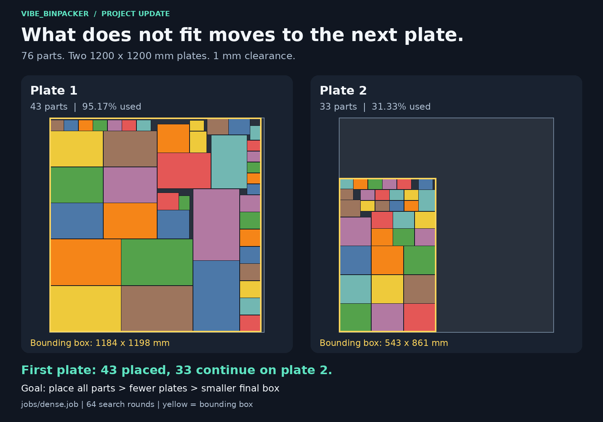
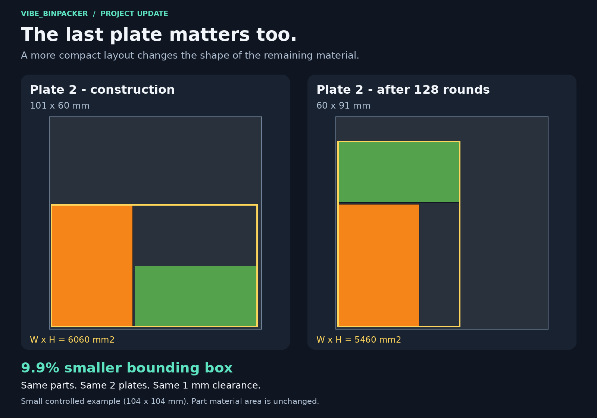
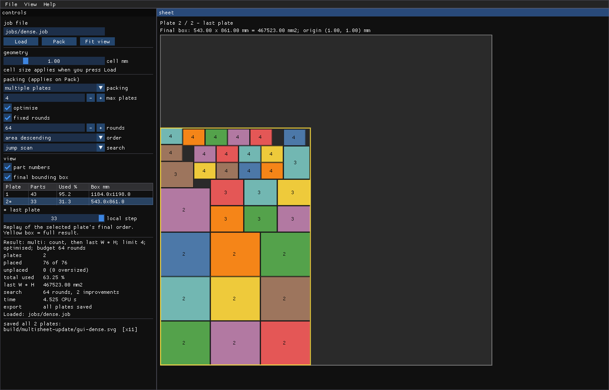

# From a full plate to a complete job

*[Deze update in het Nederlands](update_multisheet_nl.md)*

vibe_binpacker can now distribute a job across multiple identical plates.
Parts that do not fit on the first plate carry over to the next. The solver
then searches for a more compact layout on the final plate. The updated GUI
shows the distribution and the space left around the work.



## What is new?

Supply the plate dimensions, the parts and a maximum plate count. The solver
compares solutions in this order:

1. Place as many requested pieces as possible.
2. Use fewer plates.
3. Minimise the area of the enclosing rectangle on the final plate:
   **width x height**, its bounding box.

Search varies the part order, which changes assignments between plates, and
the available width on the final plate. A taller but narrower layout can
therefore beat a low, wide one. This is a heuristic search: it retains the
best solution found within its budget, without proving a global optimum.

The supplied `dense.job` contains 76 parts. Single-plate construction places
43 and leaves 33 unplaced. The multi-plate run shown here places all 76: 43
on the first plate and 33 on the second. Each plate is 1200 x 1200 mm, with
1 mm clearance. The run allows up to four plates and uses 64 search rounds;
two plates are actually used.

## Why it matters

A job is complete when the pieces that did not fit on plate 1 have a place too.
They now carry over within the same job, instead of needing a separate job
prepared by hand. You can inspect the whole job, see how many plates it uses,
and export all used plates together.

The shape of the remaining material matters as well. With the same parts on
the same number of plates, the total unused material area stays the same,
but a different arrangement can leave a wider continuous strip. The bounding
box makes the compactness of the group visible, helping you judge whether
the space around it could be useful for another job.

## The final plate: a small controlled example



In `multisheet.job`, the first part fills plate 1. The other two must go onto
plate 2. These plates are deliberately small, 104 x 104 mm, to isolate the
effect of the chosen objective.

| On plate 2 | Construction | After 128 rounds |
| --- | ---: | ---: |
| Parts | 2 | 2 |
| Bounding box | 101 x 60 mm | 60 x 91 mm |
| Bounding-box area | 6060 mm2 | 5460 mm2 |
| Part material area | 4200 mm2 | 4200 mm2 |

The enclosing rectangle is **9.9% smaller**. The job still uses two plates
and the clearance remains 1 mm. On the right, a wider free strip appears
beside the work. The 9.9% is the bounding-box improvement in this controlled
example, not a material-saving percentage or an average over production jobs.

## The GUI shows the whole result



- Select a plate in the table to inspect its parts at full size.
- Read part counts, utilisation and box dimensions per plate.
- Inspect the yellow box's origin, width, height and area.
- Replay the final placement order with the plate-local step slider.
- Export every full plate with **Save SVG**: `name-001.svg`, `name-002.svg`,
  and so on. Selection and replay do not truncate the export.

Partial results remain viewable, with a list of unplaced pieces. Export
errors report how many files were completed; the result is marked saved
only when every plate was written successfully.

## Try it

```sh
pixi run build
pixi run fetch-gui-deps
pixi run gui
./build/bp_gui jobs/dense.job --sheets 4 --search 64 --sheet 2
```

Reproduce the small comparison with:

```sh
./build/bp_pack --sheets 2 --svg build/before.svg jobs/multisheet.job
./build/bp_pack --sheets 2 --search 128 --svg build/after.svg jobs/multisheet.job
```

The illustrations are rendered from actual solver SVGs; the GUI image is a
framebuffer capture of the same configuration. The tooling independently
checks overlap, plate bounds and clearance, and compares GUI dimensions
against the CLI output.

With Python, Pillow and DejaVu Sans, the same image dependencies as the
existing comparison tool, regenerate the assets using:

```sh
python3 tools/make_multisheet_update.py
```

A working display is required for the GUI capture. Images, SVGs, CSVs and
the `measurements.json` manifest go into `build/multisheet-update/`.
`--publish` copies the five selected PNG assets into `docs/`.

[Back to the README](../README.md) ·
[Short post to share](linkedin_update_multisheet_en.md) ·
[Source on GitHub](https://github.com/edwin-oetelaar/vibe_binpacker)
