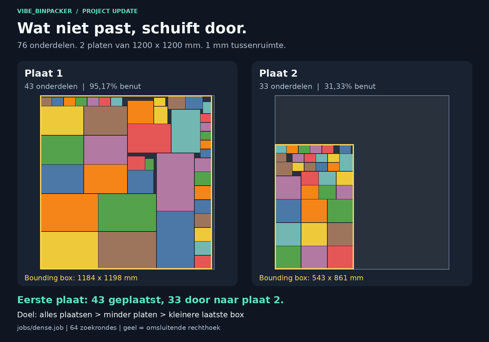
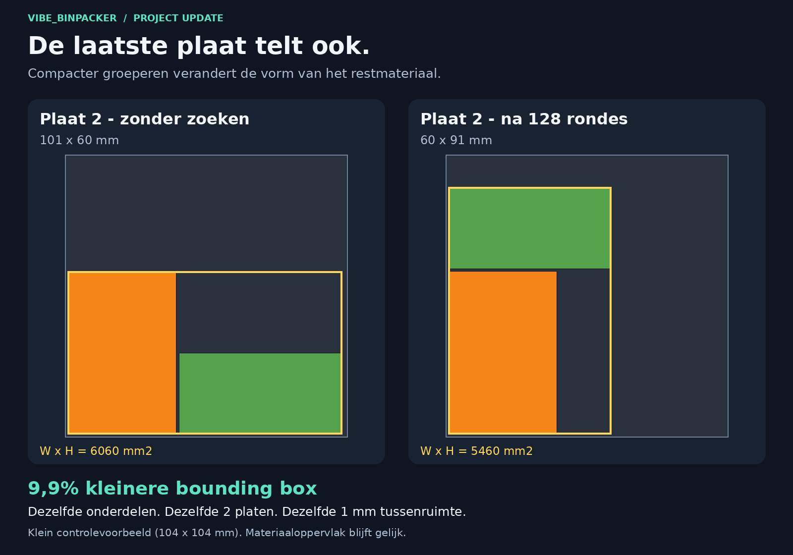
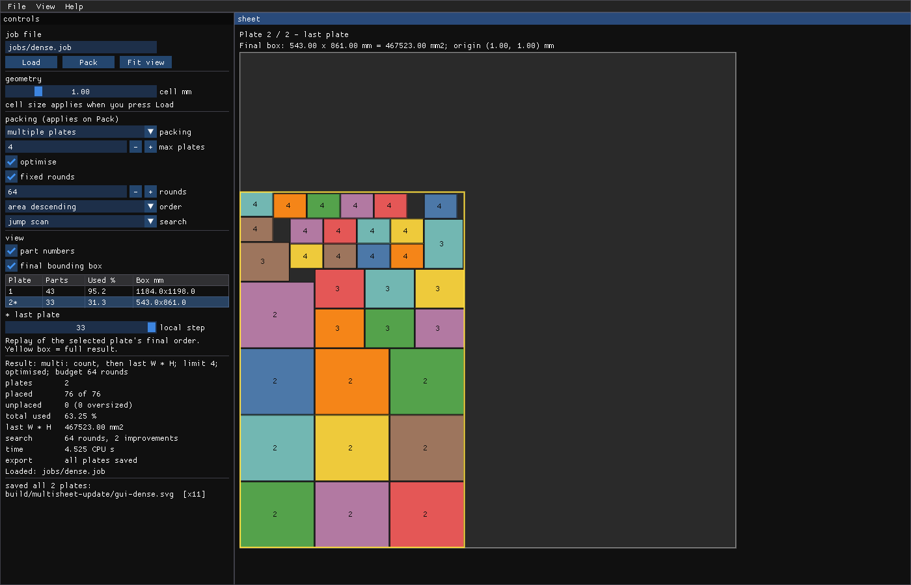

# Van een volle plaat naar een complete opdracht

*[Read this update in English](update_multisheet_en.md)*

vibe_binpacker kan nu een opdracht over meerdere identieke platen verdelen.
Onderdelen die niet meer op de eerste plaat passen schuiven door naar de
volgende. Daarna zoekt de solver naar een compactere indeling van de laatste
plaat. De vernieuwde GUI maakt de verdeling en de resterende ruimte zichtbaar.



## Wat is er nieuw?

Je geeft de plaatmaat, de onderdelen en een maximumaantal platen op. De solver
beoordeelt oplossingen in deze volgorde:

1. Zoveel mogelijk gevraagde onderdelen plaatsen.
2. Zo weinig mogelijk platen gebruiken.
3. De oppervlakte van de omsluitende rechthoek op de laatste plaat verkleinen:
   **breedte x hoogte**, oftewel de bounding box.

De zoeklaag probeert andere onderdeelvolgordes, wat ook de verdeling over de
platen verandert, en andere beschikbare breedtes op de laatste plaat. Een
hogere maar smallere indeling kan daardoor beter zijn dan een lage, brede.
Dit is een heuristische zoekmethode: hij bewaart de beste gevonden oplossing
binnen het budget en bewijst geen globaal minimum.

In de meegeleverde `dense.job` zijn er 76 onderdelen. Bij de constructie op
een enkele plaat worden er 43 geplaatst en blijven er 33 over. In de getoonde
multi-plaatrun worden alle 76 geplaatst: 43 op de eerste plaat en 33 op de
tweede. De platen zijn 1200 x 1200 mm en de tussenruimte is 1 mm. Deze run
gebruikt een maximum van vier platen en 64 zoekrondes; er worden er twee benut.

## Waarom dit nuttig is

Een opdracht is pas afgerond als ook de onderdelen die niet op plaat 1 passen
een plek hebben. Die hoef je nu niet zelf naar een tweede job over te hevelen.
Je kunt de hele opdracht bekijken, zien hoeveel platen worden gebruikt en
alle gebruikte platen samen exporteren.

Daarnaast telt de vorm van het restmateriaal. Met dezelfde onderdelen op
hetzelfde aantal platen blijft de totale ongebruikte materiaaloppervlakte
gelijk, maar een andere indeling kan een bredere, doorlopende strook vrijlaten.
De bounding box maakt zichtbaar hoe compact het werk gegroepeerd ligt. Of de
ruimte eromheen bruikbaar is voor een volgende opdracht kun je daarmee beter
beoordelen.

## De laatste plaat: een klein, controleerbaar voorbeeld



In `multisheet.job` vult het eerste onderdeel plaat 1. De andere twee moeten
naar plaat 2. De platen zijn hier bewust klein: 104 x 104 mm. Zo is het effect
van het gekozen doel goed te zien.

| Op plaat 2 | Zonder zoeken | Na 128 rondes |
| --- | ---: | ---: |
| Onderdelen | 2 | 2 |
| Bounding box | 101 x 60 mm | 60 x 91 mm |
| Oppervlakte bounding box | 6060 mm2 | 5460 mm2 |
| Oppervlakte van de onderdelen | 4200 mm2 | 4200 mm2 |

De omsluitende rechthoek wordt **9,9% kleiner**. Het aantal platen blijft twee
en de tussenruimte blijft 1 mm. Rechts ontstaat een bredere vrije strook naast
het werk. De 9,9% is de verbetering van de bounding box in dit controlevoorbeeld,
geen materiaalbesparingspercentage of gemiddelde over productieopdrachten.

## De GUI laat het hele resultaat zien



- Selecteer een plaat in de lijst en bekijk haar onderdelen op groot formaat.
- Lees aantallen, benutting en afmetingen per plaat af.
- Bekijk de gele bounding box met oorsprong, breedte, hoogte en oppervlakte.
- Speel met de lokale stappenschuif de uiteindelijke plaatsingsvolgorde af.
- Exporteer alle volledige platen met **Save SVG**: `naam-001.svg`,
  `naam-002.svg`, enzovoort. De selectie en stappenschuif beperken die export niet.

Ook gedeeltelijke resultaten zijn zichtbaar, met een lijst van onderdelen die
nog niet geplaatst zijn. Bij een exportfout blijft duidelijk welke bestanden
al geschreven zijn; het resultaat geldt pas als opgeslagen wanneer alle platen
succesvol zijn weggeschreven.

## Zelf proberen

```sh
pixi run build
pixi run fetch-gui-deps
pixi run gui
./build/bp_gui jobs/dense.job --sheets 4 --search 64 --sheet 2
```

De kleine vergelijking reproduceer je met:

```sh
./build/bp_pack --sheets 2 --svg build/before.svg jobs/multisheet.job
./build/bp_pack --sheets 2 --search 128 --svg build/after.svg jobs/multisheet.job
```

De infographics zijn getekend uit de echte SVG-uitvoer; de GUI-afbeelding is een
framebufferopname van dezelfde configuratie. Het gereedschap controleert de
indelingen onafhankelijk op overlap, plaatgrenzen en tussenruimte en vergelijkt
de GUI-afmetingen met de CLI-uitvoer.

Met Python, Pillow en DejaVu Sans, dezelfde beeldafhankelijkheden als de
bestaande vergelijkingstool, maak je de beelden opnieuw:

```sh
python3 tools/make_multisheet_update.py
```

Dit vereist een werkend display voor de GUI-opname. De beelden, SVGs, CSVs en
het meetbestand `measurements.json` komen in `build/multisheet-update/`.
Met `--publish` worden de vijf geselecteerde PNGs naar `docs/` gekopieerd.

[Terug naar de README](../README.nl.md) ·
[Korte tekst om te delen](linkedin_update_multisheet_nl.md) ·
[Broncode op GitHub](https://github.com/edwin-oetelaar/vibe_binpacker)
